# Cloud Optimization : répartir des tâches sur des VMs GCP (ESILV A5 CCC)

On exécute des programmes compilés (les *workloads*) sur trois VMs Google Compute Engine, et on cherche **où lancer chaque tâche pour finir le plus tôt possible** (le *makespan*) sans dépasser la RAM d'aucune VM.

Le dépôt suit le semestre :
- **TD1** : on mesure les workloads sur un portable.
- **TD2** : on les mesure sur des VMs GCP.
- **TD3** : on les exécute en parallèle sur 3 VMs.
- **TD4** : un premier scheduler automatique, Round-Robin, qui sert de baseline.
- **Projet** : un optimiseur qui fait mieux que Round-Robin et qui passe à l'échelle.

Équipe : _3 noms_ · Langage principal : Go (compilé, bibliothèque standard seulement) · Suivi de la grille /20 : [docs/GRILLE.md](docs/GRILLE.md)

## En bref

| | Round-Robin (baseline) | Optimiseur `opt` |
|---|---:|---:|
| Nos 9 tâches sur 3 VMs, **mesuré** (5 runs) | 15,7 s | **12,5 s (−20 %)**, prouvé optimal (prédit 12,6 s) |
| Scénario B, 10 tâches plus lourdes, **mesuré** (5 runs) | 21,1 s (de 19,7 à 25,2) | **16,2 s (−23 %)**, prouvé optimal (prédit 15,8 s) |
| Deux tâches de 2 Go et des VMs de 4 Go | plan **infaisable** (RAM dépassée) | plan faisable, optimal |
| 40 petites instances dont on connaît l'optimum | à 56 % de l'optimum en moyenne | **optimum trouvé 39 fois sur 40** |
| 1000 tâches sur 200 VMs | plans infaisables (RAM) | réparties en ~10 s, à ≤ 1,3 % de la borne inférieure |

« Prédit » veut dire calculé par notre modèle de durée. Sur les vraies VMs, le 13/11, l'écart moyen entre prédit et mesuré est de **0,5 s** sur les 5 plans (p_ij re-mesurés dans la même session, voir plus bas).

**Bonus cœurs partagés** : en ajoutant des e2-medium (moitié prix, cœurs partagés) à l'optimiseur, le même lot finit **22 % plus vite et coûte 48 % moins cher** qu'avec Round-Robin sur des VMs dédiées. C'est valable tant que les e2-medium ont du « burst » : environ 2 min de calcul après une pause. [Détails et graphiques](#bonus--vms-à-cœurs-partagés-et-burst)

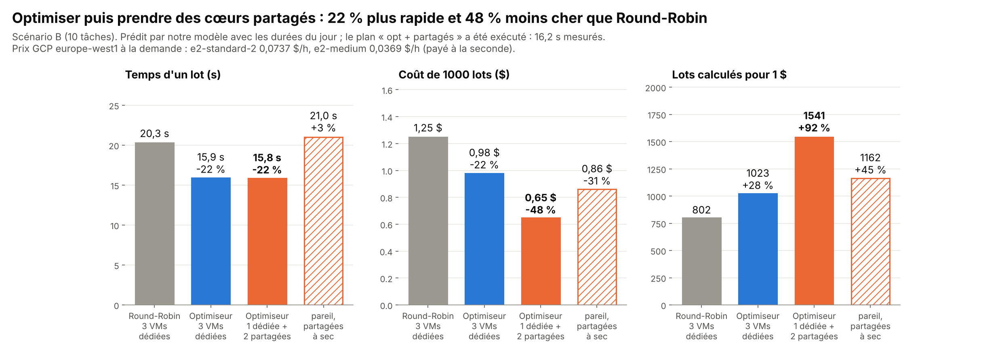

## Architecture

Le **scheduler décide**, l'**orchestrateur exécute**. Les deux ne communiquent que par un fichier CSV. On a donc pu remplacer le placement manuel (TD3) par Round-Robin (TD4), puis par l'optimiseur, **sans modifier une ligne de l'exécution**.

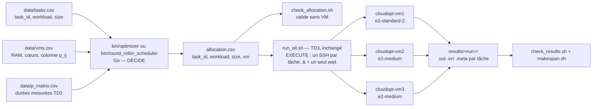

La validité est contrôlée à trois niveaux :
1. `check_allocation.sh` vérifie la sortie du scheduler, sans VM ;
2. `run_all.sh` refuse un CSV invalide **avant** de lancer quoi que ce soit ;
3. `check_results.sh` vérifie après l'exécution et sort en 1 si une tâche a échoué.

## Le parcours, TD par TD : ce qu'on a mesuré et ce qu'on en a compris

### TD1 : mesurer les workloads en local

On utilise 4 workloads Go fournis (`cpu`, `memory`, `matrix`, `sort`), chacun à 3 tailles. On fait 3 runs entrelacés plus un warm-up. Le temps mur et la RSS max sont mesurés avec GNU time.

| workload | tailles | temps moyen (s) | RSS max | croissance mesurée |
|---|---|---|---|---|
| cpu_task | 5M / 10M / 20M | 0,97 / 2,58 / 6,83 | ~2,5 Mo | N^1,41 |
| memory_task | 512 / 1024 / 2048 Mo | 0,90 / 1,48 / 2,73 | = taille | sous-linéaire en local, linéaire sur VM (effet WSL2, D20) |
| matrix_task | 1000 / 1500 / 2000 | 1,08 / 3,85 / 9,37 | 26–94 Mo | N^3,1 |
| sort_task | 10M / 20M / 40M | 1,43 / 3,07 / 6,25 | 79–308 Mo | ≈ n log n |

**Compris** :
- La durée dépend fortement du type de tâche et de sa taille. Répartir les tâches « au nombre » ne peut donc pas équilibrer la charge.
- La mémoire contraint surtout `memory_task`.
- Le bruit de mesure est faible (CV 0,5–3,6 %).

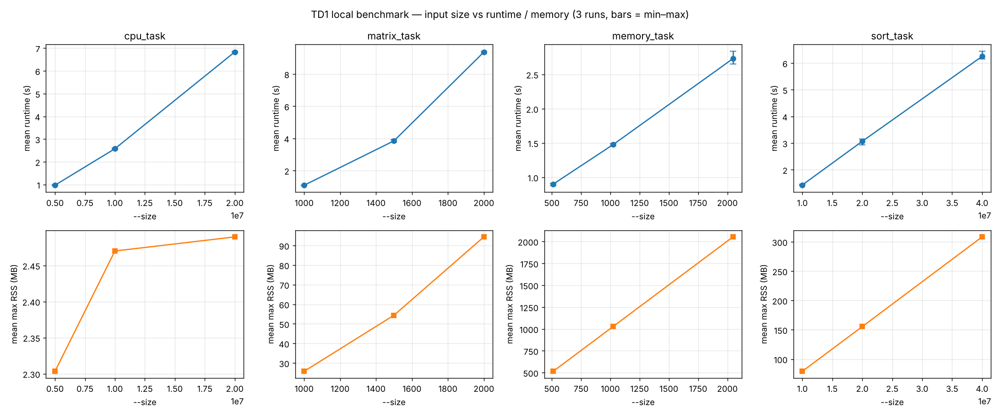

### TD2 : la même campagne sur des VMs GCP

On exécute le même runner avec les mêmes tailles et le même CSV. Seul le `TAG` de la machine change. On a mesuré deux types de VM sur la même machine virtuelle, en ne changeant que le type : c'est une **expérience témoin** (D21).

Le tableau donne le rapport temps VM / temps portable (> 1 = la VM est plus lente) :

| workload | e2-medium (cœur partagé) | e2-standard-2 | CV e2-medium → e2-standard-2 |
|---|---:|---:|---:|
| cpu_task | ×6,3 – 6,8 | ×3,7 – 3,8 | 32–39 % → ≤ 2 % |
| matrix_task | ×3,0 – 3,9 | ×1,35 – 1,40 | 6–47 % → ≤ 3,5 % |
| memory_task | ×1,8 – 2,3 | **×0,62 – 0,80** | 6–32 % → ≤ 1,8 % |
| sort_task | ×2,1 – 2,2 | ×1,01 – 1,04 | ≤ 3 % → ≤ 2,7 % |

**Compris** :
- **Le burst de l'e2-medium** : elle va à pleine vitesse tant qu'elle a des crédits, puis tombe à environ 50 %. Exemple pour `cpu 20M` : 27,9 s au premier passage, puis 52,5 s. L'e2-standard-2 reste plate (25,8 à 26,8 s).
- **Les machines ne sont pas « plus ou moins rapides » en bloc** : le rapport de vitesse dépend de la tâche (0,62 pour `memory`, 3,8 pour `cpu`). C'est le cas difficile des machines « non reliées » du CM3. D'où la **matrice `p_ij`** (`data/p_matrix.csv`), qui donne la durée de chaque tâche sur chaque type de VM (D22).
- **Coût** : l'e2-medium coûte moitié moins cher à l'heure, mais en charge continue l'e2-standard-2 coûte autant ou moins **par tâche** (D21).

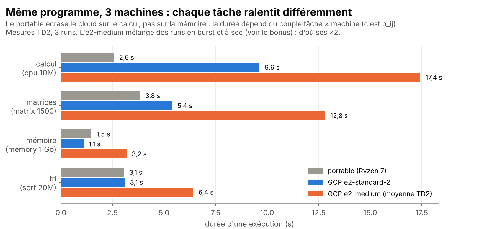

### TD3 : exécuter en parallèle sur 3 VMs

- `run_all.sh` lit un CSV `task_id,workload,size,vm` et ouvre une session SSH par tâche, lancée en arrière-plan avec `&`. Un seul `wait` attend tout le monde, puis `check_results.sh` vérifie le run (D23–D27).
- Les mêmes binaires statiques sont déployés partout, et on vérifie leur md5 (D28).

**Compris** :
- **~3 s de SSH** par tâche avant que le programme démarre : c'est un coût fixe dans chaque temps de fin.
- **Une durée dépend de ce qui tourne à côté** (CM6). Seule, `cpu 10M` dure 9,6 s ; avec 3 tâches sur la même VM, elle passe à 14,6 s. Une e2 à 2 vCPU n'a qu'un cœur physique et son hyperthread.
- Au-delà d'environ 10 SSH simultanés, sshd peut refuser des connexions (`MaxStartups`), d'où la limite de 10 tâches par VM.

### TD4 : Round-Robin, la baseline

`scheduler/round_robin.go` envoie la tâche `i` sur la VM `i mod 3`. Il ne regarde ni la durée, ni la RAM, ni le type de VM (D31–D35).

**Compris, avec nos mesures** :
- Round-Robin équilibre le **nombre** de tâches, pas leur **charge**. Les mêmes 9 tâches dans un autre ordre de fichier donnent 18,7 s au lieu de 15,8 s (+18 %), et vm1, la VM la plus rapide, reste inactive 13 s.
- Il peut produire un plan **infaisable** : deux tâches de 2 Go sur une VM de 4 Go.

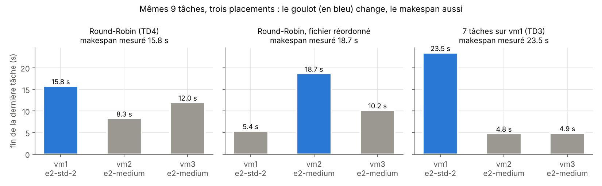

### Projet : l'optimiseur (`scheduler/optimizer.go`, détails dans [docs/OPTIMIZATION.md](docs/OPTIMIZATION.md))

**Le problème posé formellement** (CM3, CM4) :
- **Variables** : `x_ij = 1` si la tâche `i` va sur la VM `j`.
- **Contraintes** : chaque tâche va sur exactement une VM ; `Σ RSS ≤ RAM − 512 Mo` sur chaque VM, parce que toutes ses tâches tournent en même temps ; au plus 10 tâches par VM.
- **Objectif** : minimiser le makespan. À égalité, on prend le plan le plus équilibré.

**Le modèle de durée.** Les tâches d'une VM se **partagent le processeur** : la VM a `c` cœurs effectifs, et avec `n` tâches chacune avance à la vitesse `min(1, c/n)`. Le temps de fin d'une VM est donc `3 s de SSH + fin de la dernière tâche`.

On a calé `c` sur les **12 temps de fin mesurés** en TD3 et TD4 (`scripts/fit_model.py`). La meilleure hypothèse est `c = 1,25` avec toutes les VMs à la vitesse e2-standard-2. C'est cohérent avec 1 cœur + 1 hyperthread et avec le burst sur des runs courts. Erreur moyenne : 0,78 s ; en validation croisée : 0,82 s.

Validé ensuite sur les vraies VMs le 13/11 : 75 temps de fin de VM, prédits à 0,5 s près en moyenne.

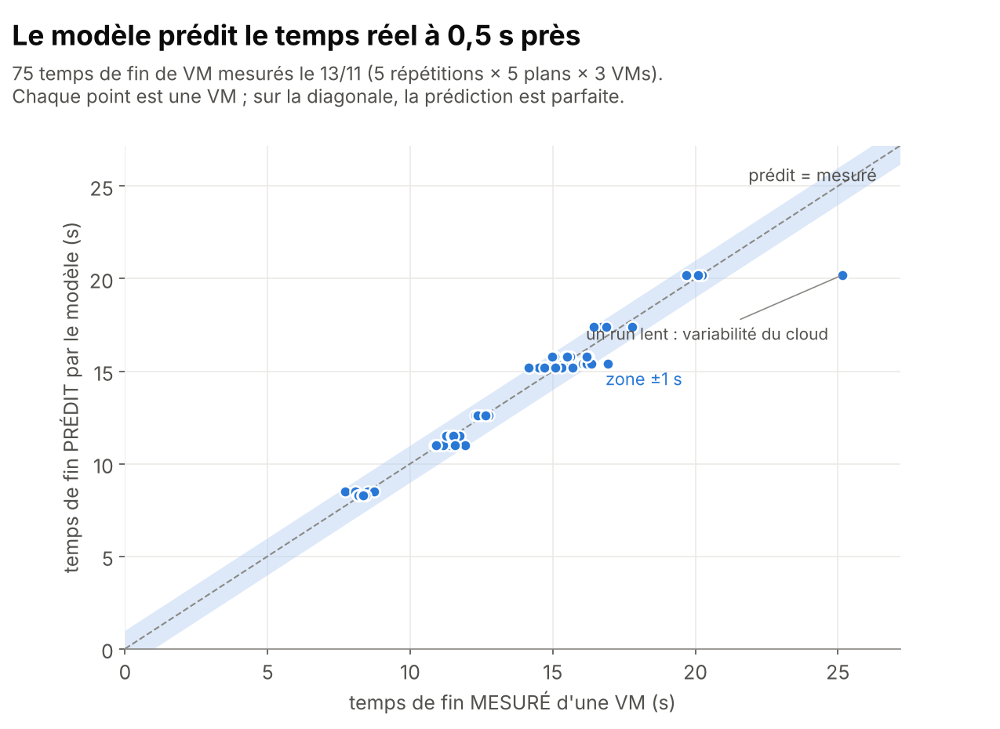

**Pourquoi ne pas essayer toutes les combinaisons ?** Il y a `M^N` plans : 19 683 pour nos 9 tâches, mais 10¹⁰⁰ pour 100 tâches sur 10 VMs. Le CM4 le dit : une recherche exacte « peut exploser avec la taille de l'instance ». On combine donc les trois familles de méthodes du cours, chacune bornée en temps :

| étage | ce qu'il fait | cours |
|---|---|---|
| 0. filtrer | une VM où la tâche ne tient pas (RAM, 10 tâches) n'est jamais proposée | CM6 « filter before score » |
| 1. construire | LPT, Min-Min et Max-Min ; on garde le meilleur plan | CM3 |
| 2. améliorer | descente : déplacer une tâche, en échanger deux, ou en échanger deux contre une, depuis la VM la plus chargée | CM5 (recherche locale) |
| 3. itérer | 200 petites perturbations suivies d'une nouvelle descente, graine fixe (résultat reproductible) | CM5 (métaheuristique) |
| 4. borner, prouver | borne inférieure ; si le plan l'atteint, il est optimal ; sinon branch and bound limité à 10 s, qui rend **OPTIMAL**, ou **FEASIBLE** avec l'écart | CM4 |

Chaque étage part du plan de l'étage précédent : il ne peut pas l'empirer.

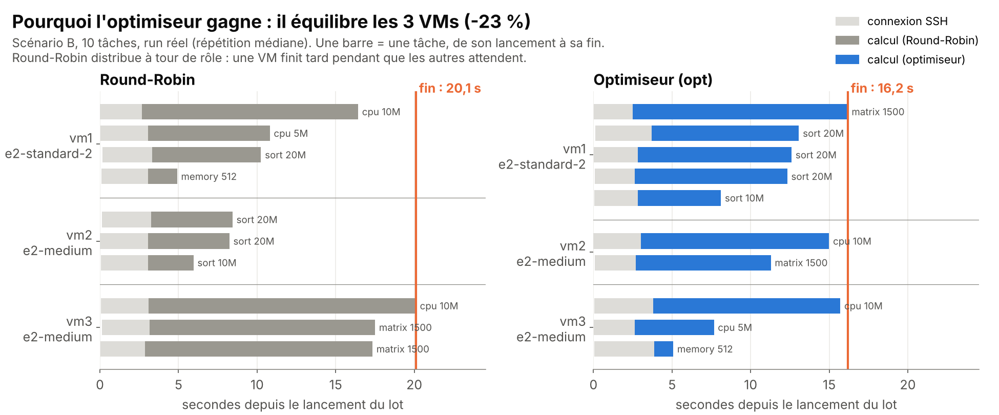

Les plans trouvés :
- **Scénario A** : la tâche `cpu 10M` seule sur l'e2-standard-2. Elle fixe la borne (3 s de SSH + 9,6 s = 12,6 s), donc personne ne peut faire mieux.
- **Scénario B** : LPT s'arrête à 17,0 s et la descente atteint 16,0 s grâce à un échange 2-contre-1. La recherche itérée trouve 15,9 s, et le branch and bound **prouve** que c'est l'optimum (908 nœuds explorés sur 59 049 plans).

**L'heuristique est-elle bonne ?** On ne l'affirme pas, on le mesure (`make scaling`, [results/scaling.md](results/scaling.md)).

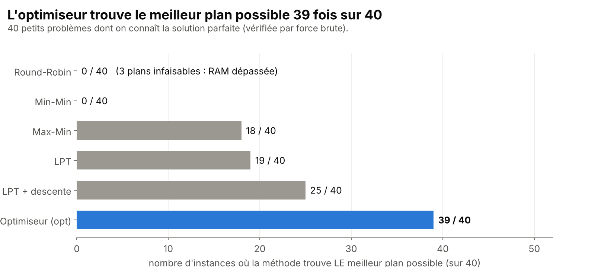

**Et quand on passe à l'échelle ?**
- Le temps de calcul reste borné par la limite de 10 s.
- L'écart à la borne inférieure majore l'écart à l'optimum. À 9–20 tâches, la recherche exacte montre que les plans sont en réalité optimaux : c'est la borne qui est loin.
- Round-Robin devient infaisable (RAM) dès 50 tâches.

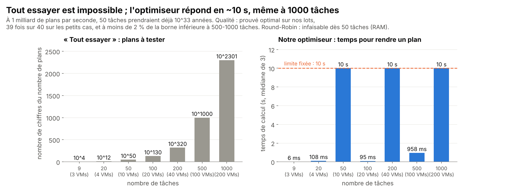

**Sur les vraies VMs (13/11).** Le premier run a fini **5× plus vite** que prévu : 7,5 s au lieu de 12,6 s pour `opt` en A. Toutes les tâches étaient plus rapides. Ce jour-là, GCP avait démarré nos VMs sur un processeur plus récent que le Broadwell du TD2 : sur E2, la plateforme CPU **n'est pas garantie**, elle peut changer à chaque démarrage. Le plan restait bon, mais les p_ij du TD2 ne valaient plus (CM4 : « wrong data, wrong plan »).

D'où `make compare-run` (D44). Dans **une seule session**, il :
1. note la plateforme CPU de chaque VM ;
2. re-mesure les 12 p_ij, chaque tâche seule, sur une e2-standard-2 et une e2-medium ;
3. ré-optimise avec ces p_ij ;
4. exécute Round-Robin, LPT et `opt` **5 fois chacun**, en tournant l'ordre des runs.

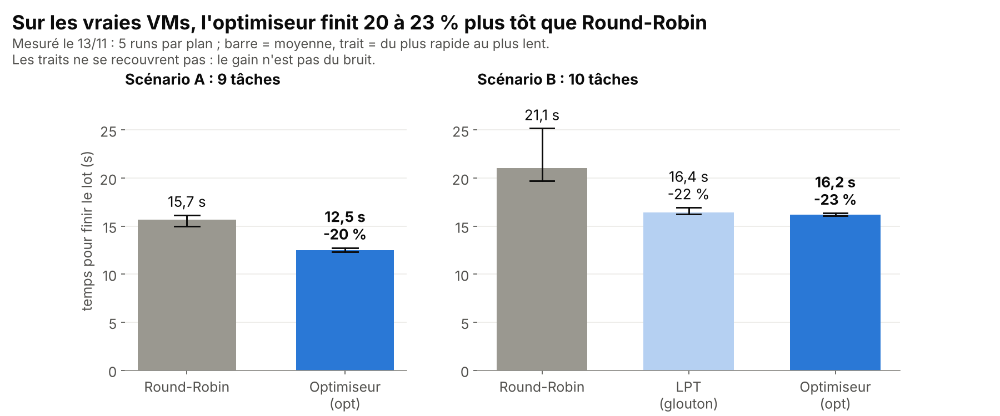

| scénario | méthode | prédit | mesuré (moyenne de 5) | min – max | vs Round-Robin |
|---|---|---:|---:|---:|---:|
| A | Round-Robin | 15,4 s | 15,7 s | 15,0 – 16,1 | — |
| A | `opt` | 12,6 s | **12,5 s** | 12,3 – 12,7 | **−20 %** |
| B | Round-Robin | 20,2 s | 21,1 s | 19,7 – 25,2 | — |
| B | LPT | 15,8 s | 16,4 s | 16,2 – 16,9 | −22 % |
| B | `opt` | 15,8 s | **16,2 s** | 16,1 – 16,4 | **−23 %** |

Ce qu'on en retient :
- Le gain prédit se retrouve en vrai, et il est **bien plus grand que la variabilité** : les min – max de RR et de `opt` ne se recouvrent pas.
- Le modèle tombe à **0,5 s près** en moyenne.
- `opt` est aussi **plus régulier** que Round-Robin : 0,3 s d'écart entre ses runs en B, contre 5,5 s.
- En B, avec les p_ij du jour, LPT tombe déjà sur l'optimum du modèle, et `opt` le **prouve** (statut OPTIMAL). LPT et `opt` sont à égalité aux erreurs de mesure près. L'optimiseur garantit qu'on ne peut pas faire mieux, il ne prétend pas battre LPT à tous les coups.

Session complète : [results/project/session_20261113_1951/summary.md](results/project/session_20261113_1951/summary.md).

## Bonus : VMs à cœurs partagés et burst

Une **e2-medium** coûte 0,0369 $/h, la moitié d'une e2-standard-2 (0,0737 $/h, europe-west1). Elle a 2 vCPU, mais ne garantit que **50 % du temps de chaque vCPU**. Quand elle a été peu utilisée, elle peut tourner à 100 % pendant un moment : c'est le **burst**. La question du prof : quand ce burst la rend-il rentable ?

### 1. Le résultat : Round-Robin → optimiseur → optimiseur + cœurs partagés


On compare le même lot (scénario B, 10 tâches) dans quatre configurations :

| | VMs louées | temps d'un lot | coût de 1000 lots | lots pour 1 $ |
|---|---|---:|---:|---:|
| Round-Robin (baseline) | 3 e2-standard-2 | 20,3 s | 1,25 $ | 802 |
| Optimiseur | 3 e2-standard-2 | 15,9 s (−22 %) | 0,98 $ (−22 %) | 1023 |
| **Optimiseur + cœurs partagés** | 1 e2-standard-2 + 2 e2-medium | **15,8 s (−22 %)** | **0,65 $ (−48 %)** | **1541 (+92 %)** |
| même flotte, e2-medium à sec | 1 e2-standard-2 + 2 e2-medium | 21,0 s (+3 %) | 0,86 $ (−31 %) | 1162 |

- **L'optimiseur** gagne du temps, et comme on paie à la seconde, il gagne aussi de l'argent.
- **Les cœurs partagés** gardent le même temps, parce que les e2-medium burstent pendant tout le lot (16 s ≪ 2 min), mais à moitié prix. Ce plan a été **exécuté** : 16,2 s mesurés.
- **À sec**, les e2-medium vont 2× moins vite : le lot reprend 5 s. Il reste moins cher, mais il devient plus lent que Round-Robin.
- Le modèle prédit même 15,8 s avec **3 e2-medium**, pour 0,49 $ les 1000 lots ([results/burst_study.md](results/burst_study.md)). C'est la flotte la moins chère, tant que les lots restent courts.

### 2. Quand est-ce qu'on burst ? (mesuré)

`make burst-study` (~36 min) : 10 min de repos, puis 7 min de calcul continu en parallèle sur une e2-medium et sur l'e2-standard-2 témoin. Ensuite, trois sondes après 1, 3 et 10 min de repos.

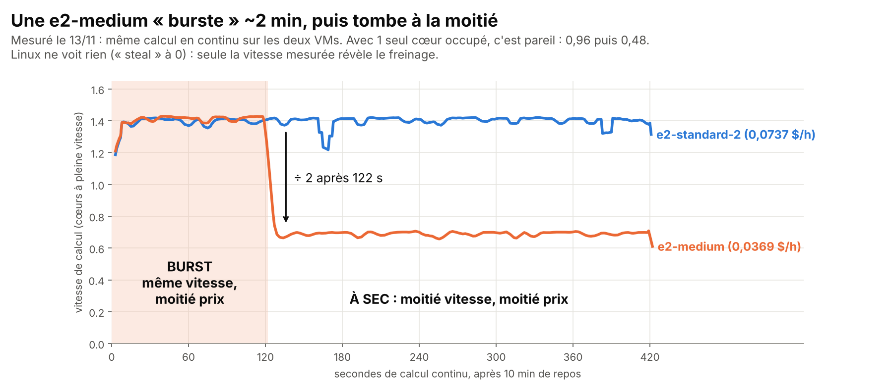

- Après une pause, l'e2-medium va **exactement aussi vite** que l'e2-standard-2.
- Au bout de **~122 s**, elle tombe d'un coup à **la moitié**, que 1 ou 2 vCPU soient occupés. C'est le « 50 % de chaque vCPU » de la fiche GCP.
- Linux ne voit pas ce freinage : le `steal` de `/proc/stat` reste à 0. Il faut mesurer la vitesse.
- **Confirmation indépendante** : en mesurant les p_ij, on avait enchaîné les tâches sans pause sur l'e2-medium. Les tâches lancées après **~120 s** de calcul cumulé ont été mesurées 2× trop lentes. C'est la même réserve, vue par une autre expérience (D47).

### 3. Sur quoi ça se base : une réserve de secondes de burst

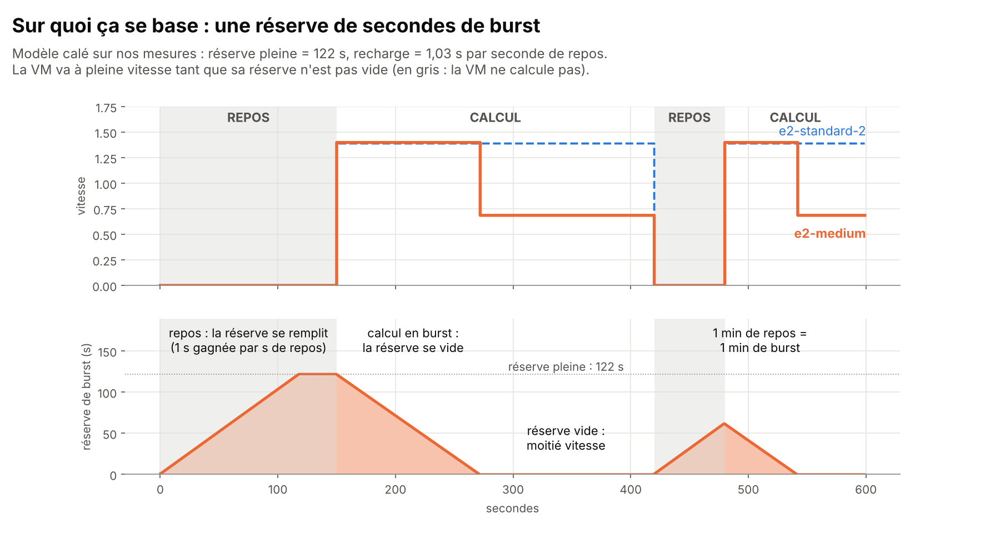

Le modèle est calé sur les sondes de récupération :
- la VM accumule une **réserve** quand elle ne calcule pas, à raison de ~1 s gagnée par seconde de repos, jusqu'à ~122 s ;
- chaque seconde de calcul en burst **vide** la réserve d'une seconde ;
- une fois la réserve vide, elle passe à **moitié vitesse**.

### 4. Quand louer une e2-medium ?

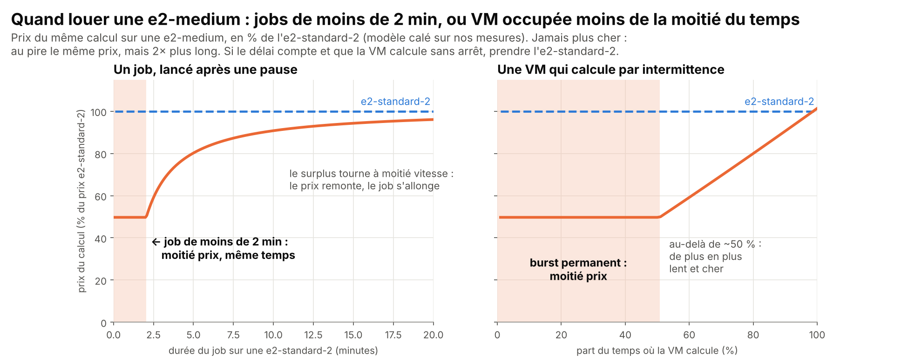

- **Job de moins de ~2 min**, lancé après une pause : même temps pour **moitié prix**.
- **VM qui calcule moins de ~50 % du temps** : les pauses rechargent ce que le calcul consomme, donc elle reste en burst en permanence. Encore moitié prix.
- **Calcul continu** : même prix que l'e2-standard-2, mais **2× plus long**. On prend l'e2-standard-2 si le délai compte.

Ce n'est jamais plus cher au calcul : le seul risque est le temps.

**Limites de l'étude** :
- une seule session, sur une seule plateforme CPU (Broadwell) ;
- les sondes de 90 s sont plus courtes que le burst complet, donc la recharge à 2 vCPU n'est connue qu'en minimum (≥ 1,5 s par seconde de repos) ; le modèle prend la valeur prudente mesurée à 1 vCPU ;
- les coûts sont **prédits** par le modèle (validé à 0,5 s près). Seul le plan « opt + cœurs partagés » a été exécuté ; les flottes de 3 VMs dédiées n'ont pas été louées.

Données : [results/burst/session_20261113_2002/](results/burst/session_20261113_2002/), [results/burst_study.md](results/burst_study.md). Graphiques : `python3 scripts/make_oral_figures.py`.

## Les choix importants (journal complet : [docs/DECISIONS.md](docs/DECISIONS.md))

| choix | pourquoi | réf. |
|---|---|---|
| Un `Makefile` comme seul point d'entrée, et le même runner partout (seul `TAG` change) | reproductible, comparaisons à conditions égales | D1, D16 |
| GNU time externe, CSV brut (une ligne par exécution), runs de 1 à 30 s, 3 runs entrelacés + warm-up | mesure honnête, pas de ligne fausse, variabilité visible | D3–D7 |
| Réutiliser les 3 VMs de l'équipe, les démarrer pour mesurer, les arrêter en fin de séance | coût maîtrisé, `inventory` vérifie ce qui reste facturé | D13, D19 |
| Expérience témoin : même VM, seul le type change | prouve le burst sans autre variable en jeu | D21 |
| L'allocation est une **donnée** (CSV), l'exécution est un **mécanisme** (scripts fixes) | on change de scheduler sans toucher à l'exécution | D23, D34 |
| Un SSH par tâche, `&` et un seul `wait` | vrai parallélisme, preuve par `ps` et par les heures de démarrage sur la VM | D24 |
| Valider avant de lancer, échecs jamais silencieux | pas de run à moitié fait | D25, D27 |
| Round-Robin de référence, en Go, comme baseline | point de comparaison simple et reproductible | D32 |
| Modèle de durée par partage du processeur, calé sur les runs réels | le modèle linéaire sous-estimait de 5 s la VM tassée | D38 |
| Construire, améliorer, borner au lieu d'énumérer | `M^N` ne passe pas à l'échelle | D39 |
| Toujours donner le plan, la borne et le statut | CM4 : « never report a value alone » | D40 |
| Mesurer la qualité contre l'optimum prouvé et contre une force brute indépendante | pas d'affirmation sans preuve | D41 |
| Pas de solveur ILP | notre modèle n'est pas linéaire, et le projet impose un langage compilé | D39 |
| Re-mesurer les p_ij dans la même session que la comparaison, 5 répétitions, ordre tourné | la plateforme CPU E2 change d'un démarrage à l'autre (premier run 5× plus rapide) | D44 |
| Étude du burst : charge, épuisement, recharge, avec un témoin e2-standard-2 | isoler l'effet des crédits ; vitesse mesurée, pas déduite du `steal` (qui reste à 0) | D45 |
| Choisir la flotte par makespan **et** coût (front de Pareto), avec le même optimiseur | e2-medium : même vitesse pour moitié prix tant qu'il reste des crédits | D46 |
| Mesurer les p_ij de l'e2-medium avec une pause après chaque run | sinon, après ~2 min, les tâches sont mesurées à sec (2× trop lentes) | D47 |

## Tests

| commande | ce qui est vérifié | résultat |
|---|---|---|
| `make test-scheduler` | Round-Robin : cas A–E du TD, déterminisme, dépendance à l'ordre | 14/14 |
| `make test-optimizer` | voir la liste ci-dessous | 48/48 |
| `check_results.sh` (à chaque run réel) | 6 points du TD : sortie, code retour, VM, chevauchement… | `CHECK OK 9/9` sur chaque run normal ; le run d'échec volontaire est bien signalé |

Ce que vérifie `make test-optimizer` :
- les allocations sont valides ;
- chaque étage fait au moins aussi bien que le précédent : `opt ≤ ils ≤ ls ≤ glouton`, et `opt ≤ rr` ;
- `opt` trouve le même optimum qu'une force brute écrite à part, et la borne est ≤ l'optimum ;
- la RAM est respectée, et une instance impossible donne une erreur sans écrire de fichier ;
- le résultat est déterministe, et une recherche interrompue n'annonce jamais OPTIMAL ;
- les prédictions collent aux runs réels à ±1,5 s ;
- 1000 tâches sont traitées dans la limite de temps.

## Limites (à assumer à l'oral)

- **L'optimum est celui du modèle.** Le modèle est calé sur 12 points, avec une erreur moyenne de 0,78 s. Un plan prouvé optimal à 12,6 s peut mesurer 13 s ou plus.
- **Burst.** Le modèle suppose que les e2-medium ont des crédits : c'est vrai pour nos lots (~16 s pour ~2 min de burst disponibles, mesuré). Pour des runs longs ou enchaînés sans pause, il faut passer leur colonne aux p_ij « à sec » (2× plus lents).
- **Variabilité du cloud.** La plateforme CPU change d'un démarrage à l'autre : le premier run était 5× plus rapide. On re-mesure donc les p_ij à chaque session. RR varie de 19,7 à 25,2 s sur 5 runs ; `opt` de 16,1 à 16,4 s.
- **Borne faible aux tailles moyennes.** L'écart affiché (10–26 %) surestime l'écart réel.
- **Petits échantillons.** Avec 3 runs par mesure, on voit la variabilité, mais on n'a pas d'intervalle de confiance solide.
- **WSL2 en local.** On n'a fait ni épinglage CPU ni fixation de la fréquence.

## Reproduire

Il faut installer git, make, gcc, Go et GNU time : `sudo apt install -y git make build-essential time golang-go`. Il faut aussi python3, et matplotlib pour les figures. Ensuite :

```bash
make check                       # outils présents ?
# TD1 (local)
make build && make calibrate && make bench && make analyze
# TD2 (une VM) — gcloud connecté, PROJECT_ID dans config/gcp.env
scripts/gcp.sh start && scripts/gcp.sh deploy && scripts/gcp.sh setup && scripts/gcp.sh bench && scripts/gcp.sh fetch
make compare && scripts/gcp.sh stop
# TD3 (3 VMs)
scripts/gcp.sh start-all && scripts/deploy_all.sh
scripts/run_all.sh data/allocation_manual.csv
# TD4 (Round-Robin)
make test-scheduler && make td4-run
# Projet (optimiseur)
make test-optimizer              # 48 tests, sans VM
make opt                         # allocations A et B, vérifiées
make opt-run                     # exécution réelle -> results/project/<allocation>/ + makespan mesuré
make compare-run                 # même session : plateforme + p_ij du jour, RR / LPT / opt × 5 -> results/project/session_*/
make burst-study                 # bonus : burst de l'e2-medium (~36 min) -> results/burst/session_*/
make burst-cost                  # bonus : temps, coût, choix de flotte -> results/burst_study.md
python3 scripts/make_oral_figures.py  # les graphiques de ce README (results/oral_*.png)
make scaling                     # passage à l'échelle -> results/scaling.md (~4 min)
make fit-model                   # recale le modèle sur tous les runs réels
python3 scripts/make_figures.py  # régénère les figures de ce README
# toujours finir par :
scripts/gcp.sh stop-all && scripts/gcp.sh inventory
```

Commandes détaillées et options : `make help`, `scripts/gcp.sh -h`, `scripts/benchmark.sh -h`.

## Arborescence

```
workloads/   sources Go fournies (non modifiées)
scheduler/   round_robin.go (TD4) ; optimizer.go (projet)
scripts/     TD1 : benchmark.sh, campaign.sh, calibrate.sh, analyze.sh, memprobe.sh
             TD2 : gcp.sh (toutes les actions Compute Engine), compare.sh
             TD3 : deploy_all.sh, run_task.sh, run_all.sh, check_results.sh, ps_all.sh
             TD4 : check_allocation.sh, test_scheduler.sh, estimate_alloc.sh, makespan.sh
             projet : test_optimizer.sh, bruteforce_check.py, fit_model.py, scaling.py, make_figures.py,
                      measure_p.sh, compare_run.sh, session_summary.py
             bonus burst : burst_study.sh, burst_analysis.py, burst_cost.py
config/      campaign.conf (tailles), gcp.env (projet, zone, VMs)
data/        mesures brutes, profils, p_matrix.csv, tasks*.csv, machines.csv, vms.csv, allocation_*.csv
results/     résumés, comparaisons, runs réels td3/ td4/ project/ (session_* = comparaison), burst/,
             model_fit.md, scaling.md, burst_study.md, figures
docs/        DECISIONS.md, GRILLE.md, OPTIMIZATION.md, TD1–TD4_ANSWERS.md, WORKLOADS.md, ENVIRONMENT.md
```

Réponses aux questions des TD : [TD1](docs/TD1_ANSWERS.md) · [TD2](docs/TD2_ANSWERS.md) · [TD3](docs/TD3_ANSWERS.md) · [TD4](docs/TD4_ANSWERS.md) · [Optimisation](docs/OPTIMIZATION.md)
