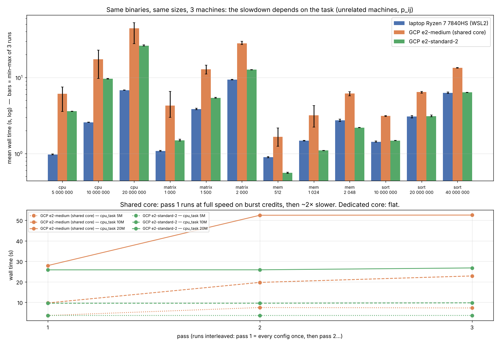

# Cloud Optimization — projet semestriel (ESILV A5 CCC)

Ordonnancement de tâches sur des VMs GCP. Ce dépôt suit les TD : **TD1 (workloads locaux et benchmarking) terminé**, **TD2 (Compute Engine) terminé**.

Équipe : _3 noms_ · Distribution Linux : Ubuntu 26.04.1 LTS (WSL2) · Machine : voir `data/machine_local.txt`

## Installation (référence Ubuntu)
```bash
sudo apt update
sudo apt install -y git make build-essential time golang-go
# optionnel : graphe
sudo apt install -y python3-matplotlib
make check            # vérifie git, make, gcc, go, GNU time
```
Autre distribution : installer les mêmes outils (git, make, gcc, Go, GNU time) avec son gestionnaire de paquets.

## Arborescence
```
workloads/   sources Go fournies (cpu_task, memory_task, matrix_task, sort_task) — non modifiées
bin/         binaires natifs (make build)
config/      campaign.conf (tailles par workload), gcp.env (projet, zone, type de VM, image, disque)
scripts/     benchmark.sh (1 workload, 1 taille, N runs), campaign.sh, calibrate.sh, machine_info.sh, analyze.sh, plot.py
             gcp.sh (toutes les actions Compute Engine), compare.sh (machine A vs B), memprobe.sh
data/        machine_<tag>.txt, benchmark_<tag>.csv (brut), campaign_meta_<tag>.txt, workload_profile_<tag>.csv, raw/<tag>/
             tag = local (TD1, portable) ou cloud_vm1 (TD2, VM GCP)
results/     summary_<tag>.md, size_vs_runtime_rss_<tag>.png, compare_local_vs_cloud_vm1.md
docs/        DECISIONS.md (journal des choix), ENVIRONMENT.md, WORKLOADS.md, TD1_ANSWERS.md, TD2_ANSWERS.md
```

## Reproduire toute l'expérience
```bash
make machine          # -> data/machine_local.txt
make build            # go build -> bin/
make calibrate        # 1 run par taille, signale les runs < 1 s ou > 30 s ; ajuster config/campaign.conf
make bench            # 3 runs entrelacés + 1 warm-up -> data/benchmark_local.csv
make analyze          # -> results/summary_local.md, data/workload_profile_local.csv, graphe
# ou tout d'un coup : make all
```
Pendant `make bench` : portable sur secteur, applications lourdes fermées.

## TD2 — rejouer la même campagne sur une VM Compute Engine
Prérequis : `gcloud` installé et connecté (`gcloud auth login`), `PROJECT_ID` renseigné dans `config/gcp.env`.
```bash
scripts/gcp.sh preflight     # compte actif, projet, API Compute Engine
scripts/gcp.sh explore       # zone, types E2, détail du type de VM et de l'image -> data/gcp_explore_cloud_vm1.txt
scripts/gcp.sh start         # nos VMs existent déjà (e2-medium) ; `create` ne sert que pour une nouvelle VM
scripts/gcp.sh describe      # statut, disque, réseau, IP interne/externe -> data/vm_cloud_vm1.txt
scripts/gcp.sh deploy        # copie le commit courant (git archive) sur la VM
scripts/gcp.sh setup         # apt install golang-go time make ; make build ; make machine TAG=cloud_vm1
scripts/gcp.sh bench         # make bench + analyze TAG=cloud_vm1 sur la VM, sans shell interactif
scripts/gcp.sh fetch         # rapatrie benchmark_cloud_vm1.csv, machine_cloud_vm1.txt, ... dans data/
make compare                 # -> results/compare_local_vs_cloud_vm1.md
scripts/gcp.sh stop          # ou delete ; puis inventory : rien de facturable ne doit rester
```
Toute variable se surcharge : `VM_NAME=cloudopt-vm2 MACHINE_TYPE=n2-standard-2 scripts/gcp.sh create`.
Les mêmes cibles `make` tournent partout, seul `TAG` change : `make bench TAG=cloud_vm1`.

## Lancer un benchmark à la main
```bash
scripts/benchmark.sh -w cpu_task -s 500000 -r 3          # ajoute 3 lignes à data/benchmark_local.csv
scripts/benchmark.sh -w matrix_task -s 400 -r 5 -o /tmp/test.csv
scripts/benchmark.sh -h
```
Erreurs détectées : binaire absent ou non exécutable, taille non entière, GNU time absent, en-tête CSV différent, exécution en échec (aucune ligne écrite dans ce cas).

## Format du CSV
`workload,size,run,runtime_s,max_rss_kb` — une ligne par exécution. `runtime_s` = temps mur (GNU time `%e`), `max_rss_kb` = RSS max (GNU time `%M`).

## Résultats TD1 (Ryzen 7 7840HS, WSL2, 36 runs, CV 0,5–3,6 %)
| workload | tailles | temps moyen (s) | RSS max | croissance mesurée |
|---|---|---|---|---|
| cpu_task | 5M / 10M / 20M | 0,97 / 2,58 / 6,83 | ~2,5 Mo | N^1,41 |
| memory_task | 512 / 1024 / 2048 Mo | 0,90 / 1,48 / 2,73 | = taille | sous-linéaire (à expliquer) |
| matrix_task | 1000 / 1500 / 2000 | 1,08 / 3,85 / 9,37 | 26–94 Mo | N^3,1 |
| sort_task | 10M / 20M / 40M | 1,43 / 3,07 / 6,25 | 79–308 Mo | ≈ n log n |

## Résultats TD2 (même campagne sur `cloudopt-vm1`, GCP europe-west1-b, Intel Broadwell, Debian 13)
Temps VM / temps portable (> 1 = VM plus lente). Matrice complète : [data/p_matrix.csv](data/p_matrix.csv).

| workload | e2-medium (cœur partagé) | e2-standard-2 | CV e2-medium → e2-standard-2 |
|---|---:|---:|---:|
| cpu_task | ×6,3 – 6,8 | ×3,7 – 3,8 | 32–39 % → ≤ 2 % |
| matrix_task | ×3,0 – 3,9 | ×1,35 – 1,40 | 6–47 % → ≤ 3,5 % |
| memory_task | ×1,8 – 2,3 | **×0,62 – 0,80** | 6–32 % → ≤ 1,8 % |
| sort_task | ×2,1 – 2,2 | ×1,01 – 1,04 | ≤ 3 % → ≤ 2,7 % |



Analyse : [docs/TD2_ANSWERS.md](docs/TD2_ANSWERS.md) (Part 12, 15) et [docs/DECISIONS.md](docs/DECISIONS.md) (D20–D22).

Détail TD1 : [results/summary_local.md](results/summary_local.md), [graphe](results/size_vs_runtime_rss_local.png).
Choix techniques et justifications : [docs/DECISIONS.md](docs/DECISIONS.md). Réponses aux questions : [docs/TD1_ANSWERS.md](docs/TD1_ANSWERS.md), [docs/TD2_ANSWERS.md](docs/TD2_ANSWERS.md). Workloads : [docs/WORKLOADS.md](docs/WORKLOADS.md). Environnement : [docs/ENVIRONMENT.md](docs/ENVIRONMENT.md). **Suivi de la grille /20 : [docs/GRILLE.md](docs/GRILLE.md).**
