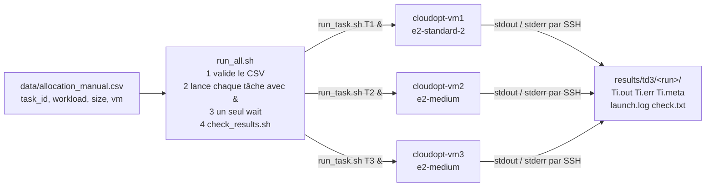

# TD3 — Exécution distribuée sur Compute Engine

Chaque partie indique le critère de la grille /20 qu'elle sert (`[G: …]`, voir `docs/GRILLE.md`). Choix détaillés : `docs/DECISIONS.md` D23–D30.
Les valeurs marquées _à relever_ viennent de l'exécution réelle sur les VMs (dossiers `results/td3/*/`).

## Architecture `[G: Architecture clarity]`



| Rôle | Fichier | Change quand on change le placement ? |
|---|---|---|
| Décision (où va chaque tâche) | `data/allocation_*.csv` | oui, c'est le seul |
| Validation + lancement + attente | `scripts/run_all.sh` | non |
| Une tâche sur une VM | `scripts/run_task.sh` | non |
| Contrôle des résultats | `scripts/check_results.sh` | non |
| Déploiement des binaires | `scripts/deploy_all.sh` | non |
| Preuve de concurrence (`ps` sur chaque VM) | `scripts/ps_all.sh` (appelé par `run_all.sh` 8 s après le lancement) | non |

## Part 1 — Les VMs `[G: Deployment on GCP VMs]`
Projet `arctic-kiln-510814-c8`, zone **`europe-west1-b`** (les 3 VMs dans la même zone), Debian 13 sur les trois.

| VM | Type | vCPU / RAM | Remarque |
|---|---|---|---|
| `cloudopt-vm1` | e2-standard-2 | 2 / 8 Go | cœur dédié (redimensionnée au TD2, D21) |
| `cloudopt-vm2` | e2-medium | 2 / 4 Go | cœur partagé, burst |
| `cloudopt-vm3` | e2-medium | 2 / 4 Go | cœur partagé, burst |

On réutilise les VMs existantes (D13) : aucune nouvelle ressource. Le parc est **hétérogène**, ce qui sera utile en TD4–TD5. Relevé (`scripts/gcp.sh start-all`, 2026-11-11) :

```
NAME          ZONE            MACHINE_TYPE   STATUS   NETWORK_IP  NAT_IP
cloudopt-vm1  europe-west1-b  e2-standard-2  RUNNING  10.132.0.2  35.205.6.138
cloudopt-vm2  europe-west1-b  e2-medium      RUNNING  10.132.0.3  35.195.94.16
cloudopt-vm3  europe-west1-b  e2-medium      RUNNING  10.132.0.4  35.241.216.47
```
Les 3 VMs démarrent en une seule commande ; `RUNNING` n'est pas « prêt » : le script attend que `sshd` réponde (vm1 a demandé ~20 s).

## Part 2 — Déploiement `[G: Deployment on GCP VMs]`
`scripts/deploy_all.sh` (D28) : compilation unique et statique, `scp` vers `~/cloud-optimization/bin/`, md5 identiques au local sur les 3 VMs, test de fumée des 4 workloads. Résultat (2026-11-11) :
- md5 des 4 binaires **identiques** sur le contrôleur et les 3 VMs (`cpu_task 322ad78f…`, `matrix_task f61efa41…`, `memory_task 031c11cd…`, `sort_task b1144a8e…`) ;
- chaque VM affiche son `hostname`, puis une ligne JSON par workload ;
- les **checksums des résultats sont identiques** sur les 3 VMs (ex. `cpu_task` 100000 → `primes_found 9592` ; `sort_task` → `1502330362` ; `memory_task` → `16167664967934279680`) : même binaire, même calcul, même résultat, quelle que soit la machine. Seule la durée varie.
- aucune installation sur vm2 et vm3 : un binaire Go statique n'a besoin d'aucune bibliothèque.

## Part 3 — Tâches et allocation manuelle `[G: Integration and validity]`
9 tâches indépendantes, les 4 workloads, tailles déjà validées en TD1/TD2 (D29).

| task | workload | size | allocation 1 (`allocation_manual.csv`) | allocation 2 (`allocation_manual_packed.csv`) |
|---|---|---:|---|---|
| T1 | cpu_task | 10 000 000 | vm1 | vm1 |
| T2 | cpu_task | 5 000 000 | vm2 | vm1 |
| T3 | matrix_task | 1500 | vm3 | vm1 |
| T4 | matrix_task | 1000 | vm1 | vm1 |
| T5 | memory_task | 1024 | vm2 | vm1 |
| T6 | memory_task | 512 | vm3 | vm1 |
| T7 | sort_task | 20 000 000 | vm1 | vm1 |
| T8 | sort_task | 10 000 000 | vm2 | vm2 |
| T9 | cpu_task | 5 000 000 | vm3 | vm3 |

Règles de validité vérifiées **automatiquement** par `run_all.sh` avant tout lancement (D25) : en-tête exact, 4 champs non vides, `task_id` unique, workload connu, taille entière, VM existante et `RUNNING`. Contrôle en plus : caractères autorisés (pas d'injection de commande dans le SSH). Contrôle fait à la main : la somme des RSS par VM tient dans sa RAM (pire cas 1,8 Go sur 8 Go).

## Part 4 — Une tâche sur une VM
```bash
gcloud compute ssh cloudopt-vm1 --zone=europe-west1-b --command="cd ~/cloud-optimization && ./bin/cpu_task --size 500000"
```
Le processus local `gcloud compute ssh` reste actif **jusqu'à la fin** de la commande distante. Enchaîner ces commandes les exécute donc l'une après l'autre : c'est le comportement à éviter.

**Observé** (2026-11-11, deux `cpu_task --size 5000000`, vm1 puis vm2, lancées l'une après l'autre) :

| | début | fin | durée vue par le contrôleur | `runtime_s` du programme |
|---|---|---|---:|---:|
| vm1 | 10:00:20 | 10:00:27 | ~7 s | 4,52 s |
| vm2 | 10:00:27 | 10:00:34 | ~7 s | 4,07 s |

1. **Séquentiel** : la tâche sur vm2 ne démarre qu'à la fin de celle sur vm1 (10:00:27), alors que les deux VMs sont indépendantes. Total ≈ 14 s ≈ somme des deux.
2. **Coût du SSH** : ~2,5 s par tâche (7 s vues par le contrôleur contre 4,5 s de calcul) pour l'authentification et l'ouverture de session. C'est pour ça qu'on garde des tâches de plusieurs secondes, et c'est un coût fixe à intégrer au modèle en TD4 (les temps `p_ij` du TD2 ne le contiennent pas).
3. Même résultat sur les deux VMs (`primes_found 348513`). (L'e2-medium vm2 n'est pas plus lente que vm1 ici : elle sort d'une longue inactivité et a ses crédits de burst, voir D21. Pas d'analyse de performance en TD3.)

## Part 5 — `run_task.sh` `[G: Orchestration and result collection]`
Interface : `scripts/run_task.sh TASK_ID WORKLOAD SIZE VM ZONE [OUTDIR]`. Vérifie les paramètres, exécute `hostname; cd ~/cloud-optimization && exec ./bin/WORKLOAD --size SIZE` sur la VM, redirige stdout vers `TASK_ID.out` et stderr vers `TASK_ID.err` **sur le contrôleur**, écrit `TASK_ID.meta` (VM, hostname distant, code de sortie, heures), et sort avec le code de la commande distante. Test sur une tâche (`scripts/run_task.sh T0 cpu_task 5000000 cloudopt-vm1 europe-west1-b results/td3/single`) :
- code de sortie **0**, 3 fichiers créés **sur le contrôleur** : `T0.out`, `T0.err`, `T0.meta` ;
- `T0.out` = la ligne JSON pure du workload (`{"task":"cpu_task","size":5000000,…,"primes_found":348513}`) ; la ligne `hostname` a bien été retirée ;
- `T0.meta` : `vm=cloudopt-vm1`, **`remote_host=cloudopt-vm1`** (placement prouvé), `exit_code=0` ;
- `T0.err` vide : pas d'erreur, et pas d'avertissement `gcloud` une fois les clés d'hôte connues.

## Part 6 — `&` et `wait`
`&` lance la commande en arrière-plan et rend la main tout de suite : les 9 processus `gcloud` partent en moins d'une seconde. `wait` bloque jusqu'à ce que **tous** les processus lancés par ce shell soient terminés. Donc : `&` = « lance et continue », `wait` = « tout est lancé, attends la fin de tout ».

Piège rencontré dans la conception (D24) : `gcloud compute ssh` lit l'entrée standard. Dans une boucle `while read`, il consommerait le reste du CSV. On lit le fichier avant de lancer, et chaque tâche reçoit `</dev/null`.

## Part 7 — Plusieurs tâches sur la même VM `[G: Distributed execution, parallel]`
Chaque tâche a sa propre session SSH, donc son propre processus sur la VM. Aucune file par VM : si 3 tâches vont sur vm1, les 3 tournent ensemble et le noyau Linux de la VM partage ses 2 vCPU entre elles. Nos workloads sont mono-thread (WORKLOADS.md) : avec 3 tâches sur 2 vCPU, chacune reçoit en moyenne ~2/3 d'un vCPU.

## Part 8 — `run_all.sh`
Saute l'en-tête, lit chaque ligne, extrait les 4 champs, appelle `run_task.sh … &`, passe à la ligne suivante, puis **un seul `wait` après la boucle**, puis `All tasks completed`, puis `check_results.sh`. Usage : `scripts/run_all.sh [ALLOCATION_CSV] [OUTDIR]`.

## Part 9 — Exécution distribuée `[G: Distributed execution, parallel]`
_à relever_ : sortie de `scripts/run_all.sh` et `results/td3/allocation_manual/ps_snapshot.txt` (processus présents en même temps sur chaque VM).

## Part 10 — Validation `[G: Orchestration and result collection]`
`check_results.sh` contrôle les 6 points du TD pour chaque tâche :

| Point du TD | Comment on le prouve |
|---|---|
| 1. lancée exactement une fois | une seule ligne par tâche dans `launch.log` |
| 2. sur la VM prévue | `remote_host` (hostname vu par la VM) = colonne `vm` |
| 3. une sortie locale par tâche | `Ti.out` contient la ligne JSON du bon workload et de la bonne taille ; aucune sortie en trop |
| 4. erreurs visibles | `Ti.err` conservé pour chaque tâche |
| 5. échecs non ignorés | `exit_code` dans `Ti.meta`, `run_all.sh` sort en 1 si une tâche échoue (test : `allocation_failtest.csv`) |
| 6. `run_all.sh` rend la main après la fin de tout | `wait` unique ; chaque `.meta` a une heure de fin antérieure au message final |

Résultat allocation 1 : _à relever_ (`results/td3/allocation_manual/check.txt`). Test d'échec : _à relever_.

## Part 11 — Autre allocation, même mécanisme `[G: Integration and validity]`
Seule la colonne `vm` change (`diff <(cut -d, -f1-3 data/allocation_manual.csv) <(cut -d, -f1-3 data/allocation_manual_packed.csv)` ne renvoie rien). Commande : `scripts/run_all.sh data/allocation_manual_packed.csv`. Aucun script modifié. Résultat : _à relever_. Comme le demande le TD, on **ne compare pas** les deux allocations en performance : ce sera l'objet du TD4–TD5.

## Nettoyage
`scripts/gcp.sh stop-all` puis `scripts/gcp.sh inventory`. Les VMs restent arrêtées pour TD4–TD5 et seront supprimées à la fin du projet (D19, D30).
