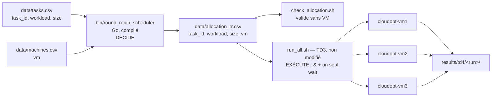

# TD4 — Du placement manuel au scheduler automatique (Round-Robin)

Chaque partie indique le critère de la grille /20 qu'elle sert (`[G: …]`, voir `docs/GRILLE.md`). Choix détaillés : `docs/DECISIONS.md` D31–D36.
Les résultats viennent de l'exécution réelle du 2026-11-11 à 12:01 (`results/td4/*/`).

**En une phrase** : le TD3 savait *exécuter* un CSV ; le TD4 ajoute un programme compilé qui *écrit* ce CSV. Round-Robin est notre **baseline** : il marche, il est reproductible, et il ne regarde rien d'autre que l'ordre des tâches. C'est précisément ce qui le rend insuffisant comme optimiseur.

## Lien avec les TD précédents

| TD | Ce qu'il a produit | Ce que le TD4 en fait |
|---|---|---|
| TD1 | 4 workloads, durée et RSS mesurées en local | les tailles des tâches viennent de là |
| TD2 | matrice `p_ij` (`data/p_matrix.csv`), RSS identique sur toutes les VMs (D22), parc hétérogène (D21) | Round-Robin **l'ignore** ; on s'en sert en Part 6 pour montrer ce qu'il rate |
| TD3 | `run_all.sh` exécute n'importe quel CSV `task_id,workload,size,vm` ; ~3 s de SSH par tâche ; ralentissement à plus de tâches que de vCPU | **inchangé** : le scheduler écrit un CSV, l'orchestrateur l'exécute (D23) |

## Architecture `[G: Architecture clarity]`



- **Scheduler** : décide où va chaque tâche. N'ouvre aucun SSH, ne lance aucun workload.
- **Orchestrateur** : lance la tâche sur la VM choisie et récupère la sortie. Aucune ligne de `run_all.sh`, `run_task.sh`, `check_results.sh` n'a changé au TD4 (`git diff origin/claude/project-thread-3n3r5o -- scripts/run_all.sh scripts/run_task.sh` vide).

Deux commandes pour tout reproduire :
```bash
./bin/round_robin_scheduler data/tasks.csv data/machines.csv data/allocation_rr.csv
./scripts/run_all.sh data/allocation_rr.csv results/td4/allocation_rr
```

## Part 1 — Séparer les tâches des choix de VM `[G: Problem formulation]`

`allocation_manual.csv` mélangeait deux informations : **quoi** exécuter et **où**. Un scheduler doit recevoir le « quoi » et le « avec quoi », et produire le « où ».

| Fichier | Rôle | Contenu |
|---|---|---|
| `data/tasks.csv` | les 9 tâches du TD3 (mêmes tailles, D29), **sans VM** | `task_id,workload,size` |
| `data/machines.csv` | les VMs disponibles, **dans l'ordre du cycle** | `vm` (une colonne, comme demandé) |
| `data/allocation_manual.csv` | placement choisi à la main au TD3, gardé pour référence | `task_id,workload,size,vm` |
| `data/allocation_rr.csv` | placement **généré**, jamais édité à la main | idem |

Mêmes tâches qu'au TD3 (D31) : on peut comparer avec les runs TD3 déjà mesurés. Mémoire : pire cas 1,1 Go sur une e2-medium de 4 Go, aucun risque (D29).

`data/vm_profile.csv` (type, vCPU, RAM, colonne de `p_ij`) n'est **pas** lu par Round-Robin. Il sert à `estimate_alloc.sh` (Part 6) et sera l'entrée machines du scheduler optimisé en TD5.

## Part 2 — Comprendre Round-Robin `[G: Baseline]`

Règle : la tâche en position `i` (0, 1, 2, …) va sur la VM `i mod M`. Avec 3 VMs : 0, 1, 2, 0, 1, 2, …

1. **10 tâches, 3 VMs** : 4, 3, 3 (vm1 reçoit T1, T4, T7, T10). Vérifié, test F.
2. **Même nombre par VM ?** Seulement si N est un multiple de M. Sinon, les `N mod M` premières VMs ont **une tâche de plus** : l'écart est au plus 1, jamais 0 garanti. Tests A (6/3 → 2,2,2) et B (5/2 → 3,2).
3. **Deux tâches de tailles très différentes** : traitées exactement pareil. Seule la position dans le fichier compte, ni la taille, ni le workload.
4. **Deux tâches sur la même VM en même temps ?** Oui. Chaque tâche a sa propre session SSH (D24), donc son propre processus ; l'OS de la VM partage les 2 vCPU. Prouvé au TD3 : 3 processus simultanés par VM, 7 sur vm1 en allocation `packed`.

## Part 3 — Le scheduler `[G: Technical quality]`

`scheduler/round_robin.go`, Go standard uniquement (`encoding/csv`, `os`, `fmt`). On a repris l'implémentation de référence du TD (D32) en la commentant. Compilation : `make scheduler` (= `go build -o bin/round_robin_scheduler scheduler/round_robin.go`).

| Fonction | Rôle |
|---|---|
| `readCSV` | lit un CSV, vérifie que l'en-tête est **exactement** celui attendu ; `encoding/csv` refuse une ligne qui n'a pas le bon nombre de champs |
| `schedule` | refuse 0 VM, une VM vide ou en double, un champ vide, un `task_id` en double ; puis `vm := vmNames[i%len(vmNames)]` |
| `writeAllocation` | écrit dans un fichier temporaire puis le renomme : jamais de CSV à moitié écrit que `run_all.sh` pourrait exécuter |
| `run` / `main` | relie le tout ; toute erreur → message sur stderr, code 1, **aucun fichier produit** |

Aucun nom de tâche ni de VM n'est écrit dans le code : le même binaire marche avec 1 VM et 9 tâches (test G) ou 7 VMs et 100 tâches (test H).

**Avant de continuer (questions du TD)** :
- La ligne de l'affectation circulaire : `vm := vmNames[i%len(vmNames)]`.
- **3 → 2 machines** : le modulo passe à 2, les tâches alternent vm1, vm2, vm1… ; T1, T3, T5, T7, T9 sur vm1 (5 tâches), T2, T4, T6, T8 sur vm2 (4). vm3 n'apparaît plus. Le code ne change pas, seul `machines.csv` change.
- **Compatible avec `run_all.sh`** : même en-tête et même ordre de colonnes ; `allocation_rr.csv` passe `check_allocation.sh` et la validation de `run_all.sh` (D25).

## Part 4 — Vérifier la sortie avant GCP `[G: Integration and validity]`

`scripts/check_allocation.sh TASKS MACHINES ALLOCATION` vérifie les règles du TD sans VM : en-tête exact, chaque tâche **exactement une fois**, aucune tâche en plus, workload et taille inchangés, toute VM présente dans `machines.csv`. Il affiche le nombre de tâches par VM. Il servira tel quel pour le scheduler du TD5 (D33).

```
$ make rr
Scheduled 9 tasks across 3 VMs: data/allocation_rr.csv
  tasks per VM: cloudopt-vm1=3 cloudopt-vm2=3 cloudopt-vm3=3
ALLOCATION OK: 9 tasks, each exactly once, unchanged, on known VMs (data/allocation_rr.csv)
```
Contrôle négatif : une allocation où T9 manque → `task T9 is missing`, `ALLOCATION INVALID`, code 1.

### Tests sans VM (`make test-scheduler`)

```
PASS  A  6 tasks, 3 VMs: vm1=2 vm2=2 vm3=2
PASS  B  5 tasks, 2 VMs: vm1=3 vm2=2
PASS  B' assignments alternate vm1 vm2 vm1 vm2 vm1
PASS  C  2 tasks, 3 VMs (vm3 gets none): vm1=1 vm2=1
PASS  D  5 tasks, 0 VMs: error -> Error: no VMs available: machines.csv must contain at least one VM
PASS  E  duplicate task ID: error -> Error: duplicate task ID "T1"
PASS  E2 wrong header in tasks.csv: error -> Error: …: column 1 must be "task_id"
PASS  E3 row with a missing field: error -> Error: read …: record on line 2: wrong number of fields
PASS  E4 duplicated VM in machines.csv: error -> Error: invalid or duplicated VM in machines.csv, data row 2
PASS  F  10 tasks, 3 VMs: vm1=4 vm2=3 vm3=3
PASS  G  9 tasks, 1 VM: vm1=9
PASS  H  100 tasks, 7 VMs: vm1=15 vm2=15 vm3=14 vm4=14 vm5=14 vm6=14 vm7=14
PASS  I  deterministic (two runs, identical files)
PASS  J  reversed task order: 6/10 tasks change VM (RR depends on the order)
---- 14 passed, 0 failed
```
Pour chaque cas d'erreur, le test vérifie aussi qu'**aucun fichier d'allocation** n'a été écrit.

**Question : si on change l'ordre de `tasks.csv`, les VMs restent-elles les mêmes ?** Non. Round-Robin est déterministe **pour un ordre donné**, mais l'affectation dépend de la position, pas de la tâche. Test J : en inversant 10 tâches, 6 changent de VM. Sur nos 9 tâches, `data/tasks_reordered.csv` (mêmes tâches, autre ordre) donne `allocation_rr_reordered.csv` : toujours 3 tâches par VM, mais vm2 reçoit T1, T3 et T2, les trois tâches les plus lourdes.

### Constat : notre allocation « manuelle » du TD3 était déjà un Round-Robin
`diff data/allocation_manual.csv data/allocation_rr.csv` est **vide**. Au TD3, on avait réparti 3 tâches par VM dans l'ordre du fichier, sans regarder les durées : c'était un Round-Robin fait à la main. Deux conséquences :
1. le run TD4 de `allocation_rr.csv` rejoue le run TD3 `allocation_manual` : c'est un **test de reproductibilité** (même entrée, même mécanisme, le makespan doit être proche de 17,6 s) ;
2. « réparti à la main » ne veut pas dire « réfléchi » : c'est la limite que la Part 6 chiffre.

## Part 5 — Brancher sur l'orchestrateur TD3 `[G: Distributed execution, parallel]`

`run_all.sh` accepte déjà un fichier en argument depuis le TD3 (`ALLOC="${1:-…/allocation_manual.csv}"`) et un dossier de sortie en 2e argument : **aucune modification**. Il lit le CSV, lance un `run_task.sh … &` par tâche, puis un seul `wait`, puis `check_results.sh`. Aucune file séquentielle par VM : les 3 tâches d'une VM tournent ensemble.

Commandes (sur le PC, VMs démarrées ; binaires déjà sur les VMs depuis le TD3, md5 vérifiés) :
```bash
scripts/gcp.sh start-all
make td4-run      # = make rr, puis run_all.sh sur allocation_rr et allocation_rr_reordered, puis makespan.sh
scripts/gcp.sh stop-all && scripts/gcp.sh inventory
```

Run réel du 2026-11-11 (12:01, `make td4-run`) : binaires redéployés, md5 identiques sur les 3 VMs, test de fumée OK, puis :

| run | `check.txt` | tâches simultanées par VM | makespan mesuré | VM la plus tardive |
|---|---|---|---:|---|
| TD3 `allocation_manual` (rappel) | `CHECK OK 9/9` | 3 / 3 / 3 | 17,6 s | vm1 (T1) |
| TD4 `allocation_rr` | **`CHECK OK 9/9`** | 3 / 3 / 3 | **15,8 s** | vm1 (T1, `cpu_task 10M`) |
| TD4 `allocation_rr_reordered` | **`CHECK OK 9/9`** | 3 / 3 / 3 | **18,7 s** | vm2 (T1, T3, T2) |

```
== allocation_rr
vm            tasks sum_runtime_s   finish_s  tasks
cloudopt-vm1      3          22.6       15.8  T1 T4 T7
cloudopt-vm2      3          10.8        8.3  T2 T5 T8
cloudopt-vm3      3          17.2       12.0  T3 T6 T9
measured makespan: 15.8 s
== allocation_rr_reordered
vm            tasks sum_runtime_s   finish_s  tasks
cloudopt-vm2      3          35.6       18.7  T1 T2 T3
cloudopt-vm3      3          16.0       10.2  T4 T7 T9
cloudopt-vm1      3           5.6        5.4  T5 T6 T8
measured makespan: 18.7 s
```

Lecture :
- **L'automatique s'exécute** : allocation générée, validée, exécutée par l'orchestrateur TD3 inchangé, 9/9 tâches OK, sur la bonne VM, 3 processus simultanés par VM (pas de file séquentielle). C'est le résultat attendu du TD4.
- **Reproductibilité** : `allocation_rr` = allocation du TD3 ; 15,8 s contre 17,6 s au TD3 (−10 %), même VM goulot (vm1, T1). Même ordre de grandeur, même goulot ; l'écart vient de la variabilité du cloud (un seul run de chaque, voir limites).
- **Même algorithme, autre ordre** : +18 % de makespan (15,8 → 18,7 s). vm1, la VM la plus rapide, a fini en 5,4 s puis est restée **inactive 13 s** pendant que vm2 travaillait encore. Voir Part 6.

`scripts/makespan.sh results/td4/<run>` : makespan = dernière fin − premier lancement, horloge du contrôleur, SSH compris. Le TD4 ne demande pas encore de mesurer le makespan ; on le relève quand même parce que c'est gratuit et que la baseline du TD5 en aura besoin.

Échecs : `run_task.sh` rend le code de la commande distante et `check_results.sh` fait sortir `run_all.sh` en 1 (testé au TD3 avec `allocation_failtest.csv`, D27). Rien à refaire.

## Part 6 — Pourquoi Round-Robin n'est pas une optimisation `[G: Interpretation and limitations]` `[G: Objective(s)]`

Round-Robin produit une allocation à partir de **l'ordre des tâches et de la liste des VMs**, rien d'autre. Un nombre de tâches équilibré n'est pas une charge équilibrée.

`scripts/estimate_alloc.sh` lit une allocation avec les informations que Round-Robin ignore (`p_ij` du TD2, RSS, vCPU, RAM). Ce n'est pas un scheduler, c'est une lecture. Estimation volontairement simple : `3 s de SSH + max(tâche la plus longue, somme des p_ij / vCPU)`, c'est-à-dire un partage parfait des vCPU.

| allocation (9 tâches, 3/3/3) | VM goulot | somme p_ij sur cette VM | makespan estimé | mesuré |
|---|---|---:|---:|---:|
| `allocation_rr` = manuelle TD3 | vm3 (T3, T6, T9) | 20,6 s | 15,8 s | 15,8 s (TD4), 17,6 s (TD3) ; goulot réel vm1 |
| `allocation_rr_reordered` | vm2 (T1, T3, T2) | 36,4 s | 21,2 s | **18,7 s**, goulot réel vm2 |

Même algorithme, mêmes tâches, même nombre de tâches par VM ; seul l'ordre du fichier change, et la VM la plus chargée reçoit plus de **dix fois** plus de travail que la moins chargée (36,4 s contre 3,1 s estimés sur vm1, qui est pourtant la VM la plus rapide).

**Mesuré** : vm2 cumule 35,6 s de calcul (`runtime_s`) et finit à 18,7 s ; vm1 cumule 5,6 s et finit à 5,4 s, puis attend 13 s sans rien faire. Le makespan augmente de 18 %. Charge équilibrée en **nombre** (3/3/3), déséquilibrée en **temps**. L'estimation (21,2 s) désigne le bon goulot et le bon ordre de grandeur.

**Faisabilité (CM6, « Round Robin alone may produce an invalid plan »)** : `data/tasks_ram_trap.csv` met deux `memory_task 2048` en positions 2 et 5. Round-Robin les envoie toutes les deux sur vm2 :
```
cloudopt-vm2  e2-medium  2  …  4108/4096  …  R2 R5  <- RAM OVER CAPACITY: infeasible
INFEASIBLE: 1 VM(s) would run out of RAM (do NOT run this allocation)
```
4,1 Go de RSS sur une VM de 4 Go (dont ~300 Mo pour l'OS) : le noyau tuerait une tâche (OOM). Exemple sur papier, **non exécuté**. vm1 (8 Go) aurait pu les prendre toutes les deux.

### Questions de discussion
1. **Deux tâches CPU lourdes sur une même VM ?** Nos workloads sont mono-thread et nos VMs ont 2 vCPU, donc 2 tâches devraient tenir. Mais sur GCP un vCPU est un **hyperthread** : vm1 (e2-standard-2) a 1 cœur physique et 2 threads (`data/machine_cloud_vm1_std2.txt` : `Thread(s) per core: 2`, `Core(s) per socket: 1`). Deux tâches CPU se partagent les mêmes unités de calcul. Mesuré au TD3 : `cpu_task 10M` dure 9,6 s seule, **14,6 s** à trois sur vm1 ; en allocation `packed` (7 tâches), la somme des `runtime_s` sur vm1 passe à 78 s pour 25 s de travail mesuré seul. Empiler des tâches lourdes allonge chacune d'elles.
2. **VMs de vCPU ou de RAM différents ?** Round-Robin n'en tient pas compte. Notre parc est hétérogène : vm1 a 8 Go et un cœur dédié, vm2 et vm3 ont 4 Go et un cœur partagé (burst, D21). Round-Robin leur donne le même nombre de tâches.
3. **Informations nécessaires** : pour chaque tâche, sa durée estimée par VM (`p_ij`, TD2) et sa mémoire (`m_i` = RSS, identique partout, D22) ; pour chaque VM, vCPU, RAM et prix horaire ; le coût fixe du SSH (~3 s, TD3) ; et un modèle de contention quand il y a plus de tâches que de vCPU (TD3).
4. **Objectif retenu pour notre stratégie** (proposition pour le TD5, D36) : **minimiser le makespan** sous la contrainte de RAM de chaque VM, avec le coût (€) mesuré à côté. C'est le problème du CM3 (machines hétérogènes, Min-Min / Max-Min, LPT) et du CM4 (ILP : makespan `T`, contrainte de capacité, comparaison à l'optimum).

### Paragraphe demandé (une limite, l'information pour la lever)
Round-Robin équilibre le **nombre** de tâches, pas leur **charge**. Avec nos 9 tâches, il suffit de changer l'ordre du fichier pour que la VM goulot passe de 20,6 s à 36,4 s de travail cumulé (mesuré : makespan 15,8 → 18,7 s, et vm1, la plus rapide, reste inactive 13 s), et il peut même envoyer deux tâches de 2 Go sur une VM de 4 Go. Pour lever cette limite, le scheduler doit connaître, pour chaque tâche, sa durée sur chaque type de VM et sa mémoire, et pour chaque VM sa RAM et son nombre de vCPU. Nous avons déjà mesuré ces données : la matrice `p_ij` et les RSS du TD2, les capacités dans `data/vm_profile.csv`. Le TD5 s'en servira pour choisir l'affectation qui minimise le makespan tout en respectant la RAM de chaque VM, et Round-Robin restera la baseline de comparaison.

## Part 7 — Structure à la fin du TD4 `[G: Technical quality and reproducibility]`

```
scheduler/round_robin.go          # Go, compilé dans bin/round_robin_scheduler
data/tasks.csv  machines.csv      # entrées du scheduler (tasks_reordered.csv, tasks_ram_trap.csv : expériences Part 4/6)
data/vm_profile.csv               # capacités des VMs (lu par estimate_alloc.sh, futur TD5)
data/allocation_manual.csv        # TD3, gardé
data/allocation_rr*.csv           # générés par make rr, jamais édités
scripts/check_allocation.sh       # validité d'une allocation générée, sans VM
scripts/test_scheduler.sh         # cas A–E + déterminisme + ordre
scripts/estimate_alloc.sh         # lecture d'une allocation avec p_ij, RSS, RAM (Part 6)
scripts/makespan.sh               # makespan mesuré d'un run
scripts/run_all.sh run_task.sh    # TD3, inchangés
results/td4/                      # runs réels
```

## Limites du TD4
- `estimate_alloc.sh` suppose un partage parfait des vCPU : il **sous-estime** quand il y a plus de tâches que de cœurs physiques (vm1 TD3 : 12,6 s estimés, 17,6 s mesurés). Il **surestime** les e2-medium quand elles ont des crédits de burst (vm3 TD3 : 15,8 s estimés, 10,5 s mesurés, D21). C'est un outil de lecture, pas un résultat ; le TD5 devra mesurer, pas seulement estimer.
- Le makespan mesuré inclut ~3 s de SSH par tâche, en parallèle : c'est la durée vécue par l'utilisateur, pas le temps de calcul.
- Un seul run par allocation : on voit l'ordre de grandeur, pas la variance (même limite qu'aux TD précédents).
